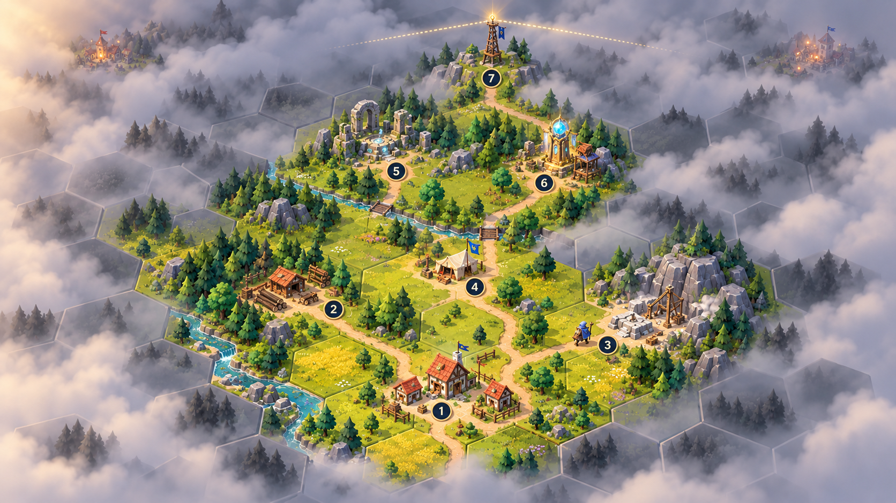

# MERGEFORGE

**A persistent collaborative browser hexworld expanded through reviewed pull requests.**

> Project status: design and playable-MVP specification. Application development has not started yet.

MERGEFORGE begins as a deliberately small but complete strategy game: found a village, uncover a procedural hex world through roads, secure wood and stone, send out a Pathfinder, restore an ancient relay and receive the first signals from distant settlements.

Every approved extension can add new possibilities to the same living world: buildings, units, resources, automation, events, minigames, PvE, PvP or interface modules.

## Confirmed direction

- Visual style: **Diorama Lite**
- Platform: browser, with desktop and touch input in mind
- World: persistent and procedurally generated
- Expansion: connected road network and fog of war
- MVP resources: wood and stone
- First unit: Pathfinder
- First minigame: Signalworks
- Identity: internal MERGEFORGE player ID linked to GitHub for the MVP
- Contribution model: reviewed pull requests and backwards-compatible modules
- License: MIT

## Source of truth

- [`docs/MERGEFORGE_Project_Bible_and_Agent_Handoff.md`](docs/MERGEFORGE_Project_Bible_and_Agent_Handoff.md)
- [`docs/MERGEFORGE_Economy_Exploration_and_Time_Model.md`](docs/MERGEFORGE_Economy_Exploration_and_Time_Model.md)
- [`docs/DECISIONS.md`](docs/DECISIONS.md)
- [`CONTRIBUTING.md`](CONTRIBUTING.md) — branch flow and pull-request contract

Older pitch material is kept for design history. When documents disagree, the hierarchy defined in the project bible applies.

## Current concept art

- [`concept-art/phase-2/04-style-a-diorama-lite.png`](concept-art/phase-2/04-style-a-diorama-lite.png) — confirmed visual direction
- [`concept-art/phase-2/07-minigame-signalwerk.png`](concept-art/phase-2/07-minigame-signalwerk.png) — first modular minigame
- [`concept-art/phase-3/08-first-seven-days-continuous-map.png`](concept-art/phase-3/08-first-seven-days-continuous-map.png) — valid spatial representation of the prologue

## Implementation gate

No application code is added until the playable blueprint and MVP boundaries are approved. The first implementation milestone will be a persistent, pannable and zoomable procedural hex map with village spawning and fog of war.
