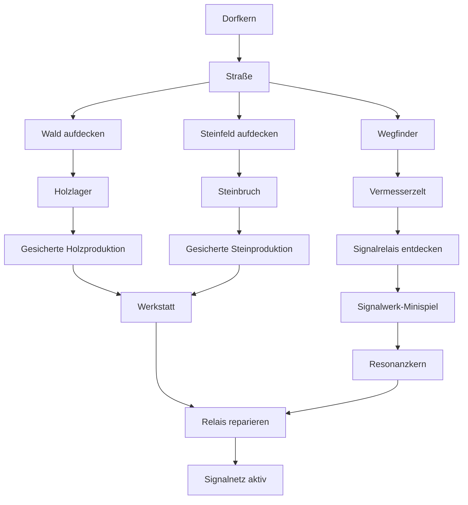
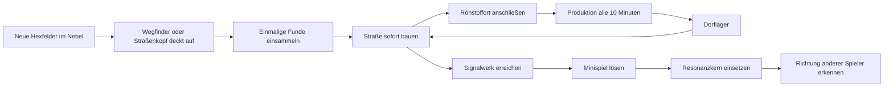

# MERGEFORGE — Wirtschaft, Erkundung und Zeitmodell

**Status:** Konzeptentscheidung v1.1  
**Visueller Stil:** Stil A — Diorama Lite  
**Umsetzungsstatus:** Pitch/Planung, noch keine App  
**Zweck:** Verbindliche Grundlage für MVP-Planung und spätere Agenten-/Contributor-Aufgaben

## 1. Die Kernentscheidung

MERGEFORGE ist kein tägliches Aufbauspiel mit Login-Zwang. Die „ersten sieben Spieltage“ sind sieben selbstbestimmte **Kapitel**. Ein Kapitel endet durch ein sichtbares Ziel, nicht um Mitternacht.

- Aktive Eingaben wie Straße setzen, Wegfinder bewegen, Fundstücke einsammeln und das Signalwerk spielen reagieren sofort.
- Produktion und Baufortschritt laufen auf einem serverweiten **10-Minuten-Welttakt**.
- Fortschritt läuft offline weiter, bis das Lager voll ist.
- Es gibt im MVP keine Energie, keine täglichen Belohnungen und keine Bestrafung für Pausen.
- Der Prolog dauert ungefähr 2–4 Stunden aktive Spielzeit und darf über beliebig viele echte Tage verteilt werden.

## 2. Weltgröße und Abstand zwischen Spielern

Jedes Dorf beginnt in einer eigenen Gründungszone mit garantiertem Wald, Steinvorkommen und einem später erreichbaren Relais.

| Regel | MVP-Wert |
|---|---:|
| Abstand zum nächsten Spielerdorf | 18–24 Straßenfelder |
| Garantiert freie Gründungszone | Radius 5 Hexfelder |
| Anfangssicht | Dorfhex + 6 Nachbarfelder |
| Entfernung zum lokalen Signalrelais | 8–12 Straßenfelder |
| Erster Hinweis auf andere Spieler | Kapitel 7, nur Richtung und grobe Entfernung |
| Physischer Erstkontakt | Erst nach dem Prolog |

Startzonen dürfen sich nicht überschneiden. Andere Dörfer sind anfangs weder sichtbar noch direkt erreichbar. Das verhindert frühes Bedrängen und gibt jedem Spieler Zeit, sein erstes Straßennetz zu verstehen.

## 3. Wie Straßen die Welt aufdecken

Straßen sind im MVP zugleich Transportnetz, Reichsausdehnung und Erkundungswerkzeug.

1. Eine Straße darf nur auf einem sichtbaren, begehbaren Hex gebaut werden, das an das bestehende Straßennetz grenzt.
2. Der Bau kostet **1 Holz** und ist im MVP sofort abgeschlossen.
3. Das neue Straßenhex deckt seine direkt angrenzenden Hexfelder auf.
4. Aufgedeckte Felder zeigen Gelände und einmalige Oberflächenfunde; Rohstoffgebäude benötigen eine Straßenverbindung.
5. Der Wegfinder kann vom Straßenkopf aus ein zusätzliches angrenzendes Nebelfeld untersuchen.
6. Besitz entsteht nicht durch bloße Sicht, sondern erst durch eine verbundene Straße oder ein angeschlossenes Gebäude.

So entsteht die typische Schleife: **Straße bauen → Gelände lesen → Abzweigung wählen → Rohstoffquelle anschließen → weiter vorstoßen.**

## 4. Rohstoffe: einmalig oder wiederkehrend?

Beides — aber mit klar getrennten Rollen.

### Einmalige Oberflächenfunde

- Fallholz, lose Steine und alte Vorratskisten erscheinen auf neu aufgedeckten Feldern.
- Sie werden einmal eingesammelt und respawnen im MVP nicht.
- Sie finanzieren die ersten Straßen und verhindern, dass der Spieler auf den ersten Produktionstakt warten muss.
- Jede Gründungszone garantiert insgesamt mindestens **6 Holz und 4 Stein** als Funde.

### Wiederkehrende Produktion

- Ein angeschlossenes Holzlager produziert **2 Holz pro Welttakt**.
- Ein angeschlossener Steinbruch produziert **1 Stein pro Welttakt**.
- Der Takt läuft alle 10 realen Minuten und auch offline.
- Produktion landet automatisch im Dorflager; es gibt keinen Abholklick.
- Das Startlager fasst **300 Holz und 150 Stein**. Das entspricht ungefähr 24 Stunden Grundproduktion je Rohstoff. Bei vollem Lager pausiert nur die jeweilige Anlage; bereits erzeugte Rohstoffe gehen nicht verloren.
- Rohstoffquellen erschöpfen im MVP nicht. Endliche Adern, Aufforstung und Logistik sind spätere PR-Module.

### Startbestand

Das Dorf beginnt mit **12 Holz und 6 Stein**. Zusammen mit den garantierten Funden reicht das sicher für die ersten Straßen und Produktionsgebäude. Ein unglücklicher Welt-Seed kann den Spieler dadurch nicht blockieren.

## 5. Bauphasen und Timer

Es gibt einen Bauplatz im Dorf. Ein Bauauftrag reserviert seine Kosten sofort und beginnt ohne weitere Bestätigung. Der aktuelle 10-Minuten-Takt zählt anteilig, damit ein Auftrag nie länger als seine nominelle Zeit plus wenige Sekunden dauert.

| Objekt | Kosten | Bauzeit | Wirkung |
|---|---:|---:|---|
| Straße | 1 Holz | sofort | Verbindet und deckt Nachbarfelder auf |
| Holzlager | 4 Holz, 1 Stein | 10 Min. | +2 Holz je Takt |
| Steinbruch | 3 Holz, 1 Stein | 10 Min. | +1 Stein je Takt |
| Wegfinder | 2 Holz, 2 Stein | 10 Min. | Bewegliche Erkundungseinheit |
| Vermesserzelt | 3 Holz, 1 Stein | 10 Min. | Erhöht gespeicherte Erkundungsaktionen |
| Werkstatt | 6 Holz, 4 Stein | 20 Min. | Erlaubt Relais-Reparatur |
| Signalrelais-Reparatur | 5 Holz, 6 Stein + Kern | 30 Min. | Aktiviert das erste Fernsignal |

Während ein Gebäude entsteht, bleiben Straßenbau, Erkundung, Sammeln und Minispiel verfügbar. Der Spieler soll nie nur auf einen Timer starren müssen.

## 6. Der Wegfinder

Der Wegfinder ist die erste Einheit und kein Kämpfer.

- Er bewegt sich sofort und kostenlos auf dem eigenen verbundenen Straßennetz.
- Am Straßenkopf kann er mit **1 Expeditionsladung** ein angrenzendes unbekanntes Hex untersuchen.
- Eine Ladung entsteht alle 10 Minuten; maximal 6 werden gespeichert.
- Das Vermesserzelt erhöht den Speicher auf 12. Dadurch lohnt sich eine Rückkehr nach längerer Pause, ohne Login-Zwang zu erzeugen.
- Der Wegfinder entdeckt Gelände, Gefahrenhinweise, Oberflächenfunde und das Signalwerk, beansprucht aber kein Land allein.

## 7. Die ersten sieben Kapitel

| Kapitel | Spielerlebnis | Sichtbares Abschlussziel |
|---|---|---|
| 1 — Der Gründungsring | Dorf verstehen, Anfangssicht lesen, Oberflächenfunde sammeln | Zwei Straßenfelder bauen |
| 2 — Die Waldlinie | Straße 3–4 Hexfelder zum Wald führen | Holzlager anschließen und erste Produktion erhalten |
| 3 — Die Steinlinie | Wegfinder ausbilden und einen zweiten Straßenarm beginnen | Steinbruch anschließen |
| 4 — Die Weggabel | Vermesserzelt bauen und zwischen zwei Geländewegen wählen | Acht zusammenhängende Straßenfelder besitzen |
| 5 — Das tote Signal | 8–12 Felder tief in die Wildnis vorstoßen | Verlassenes Relais und Signalwerk entdecken |
| 6 — Der Resonanzkern | Signalwerk-Minispiel lösen, Werkstatt errichten | Kern bergen und Relais reparieren |
| 7 — Das erste Signal | Kern einsetzen und Mast aktivieren | Richtungsimpulse anderer Siedlungen empfangen |

Nach Kapitel 7 kennt der Spieler die ungefähre Richtung und Entfernung von zwei Nachbarn. Deren Karten bleiben im Nebel. Das neue gemeinsame Ziel liegt ungefähr zwischen den Siedlungen: Straßen annähern, ein Weltprojekt entdecken und erst danach Kontakt herstellen.

## 8. Wozu dient der Resonanzkern?

Der Resonanzkern ist **keine weitere Währung**. Er ist ein einzigartiger Questgegenstand und die Batterie des lokalen Signalnetzes.

Der Spieler gewinnt genau einen Kern durch das Signalwerk-Minispiel und setzt ihn dauerhaft in das Relais ein. Er verschwindet nicht, sondern bleibt sichtbar im Bauwerk.

Im MVP bewirkt er vier Dinge:

1. Er aktiviert den Signal-Mast als Abschluss des Prologs.
2. Er enthüllt Richtung und grobe Entfernung zu entfernten Spielerdörfern, aber nicht deren Gelände.
3. Er markiert ein gemeinsames Weltziel zwischen den Spielern.
4. Er setzt intern die Fähigkeit `signal_network_active`. Spätere PR-Module können diese Fähigkeit als Voraussetzung verwenden.

Später könnten zusätzliche Kerne Portale, Maschinen, Welt-Events oder kooperative Anlagen speisen. Im MVP ist der Kern weder farmbar noch handelbar und kann nicht verloren gehen.

## 9. Das Signalwerk-Minispiel

In einer alten Relaisstation dreht der Spieler Runenplatten, bis eine Energielinie vom blauen Kristall zur goldenen Fassung reicht.

- Dauer: 60–90 Sekunden
- Eingabe: Maus oder Touch
- Seed-basiert und eindeutig validierbar
- Kein Zeitdruck und kein Scheitern mit Ressourcenverlust
- Belohnung: der einzigartige Resonanzkern und der Bauplan „Signalrelais reparieren“

Das Minispiel ist ein Beweis für den späteren Erweiterungsvertrag: derselbe isolierte Slot kann durch genehmigte PRs weitere Spiele erhalten, ohne die Weltlogik umzubauen.

## 10. Erster Bau- und Freischaltbaum

Der Baum ist absichtlich kurz. Er zeigt schon im MVP zwei parallele Entscheidungen — Versorgung aufbauen oder Erkundung beschleunigen — und führt beide erst am Relais wieder zusammen.

## 11. Ablauf in einem Satz

## 12. Bewusst nicht im MVP

- Kampf, Armeen und Plünderung
- Handel oder Marktplatz
- Förderbänder, Fahrzeuge oder komplexe Logistik
- Nahrung, Bevölkerung, Moral oder Steuern
- Erschöpfende Rohstoffadern
- tägliche Quests, Energie oder Echtgeld-Beschleunigung
- direkte Sicht auf fremde Territorien
- mehrere parallel laufende Bauplätze

Diese Systeme bleiben mögliche, klar abgegrenzte PR-Erweiterungen. Sie dürfen den sicheren Start und die Kernschleife nicht rückwirkend blockieren.
