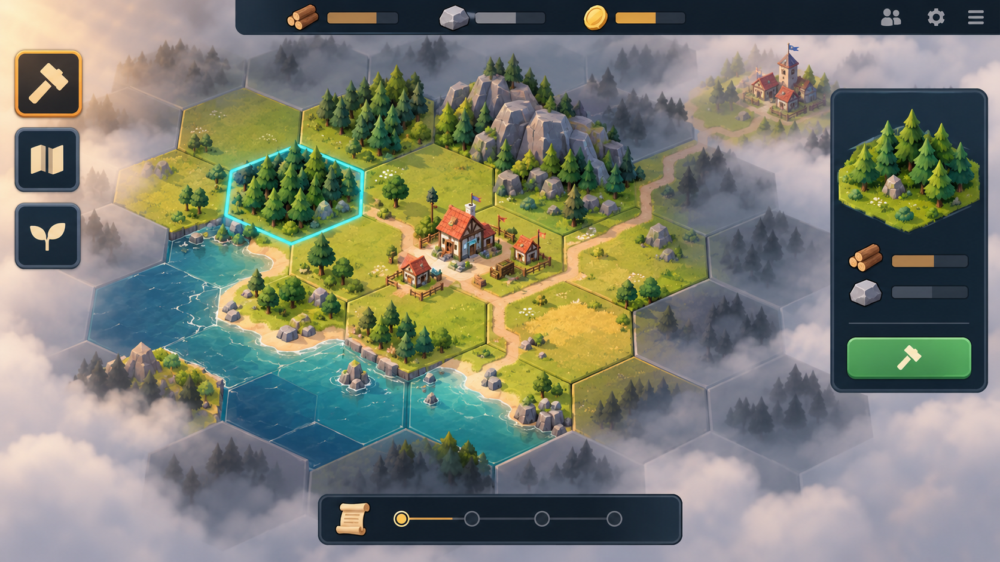
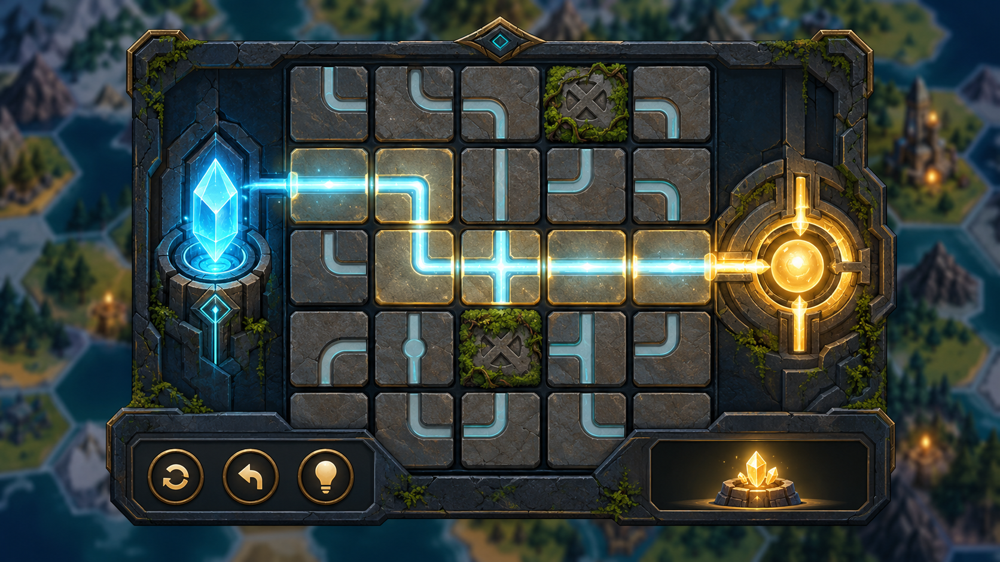
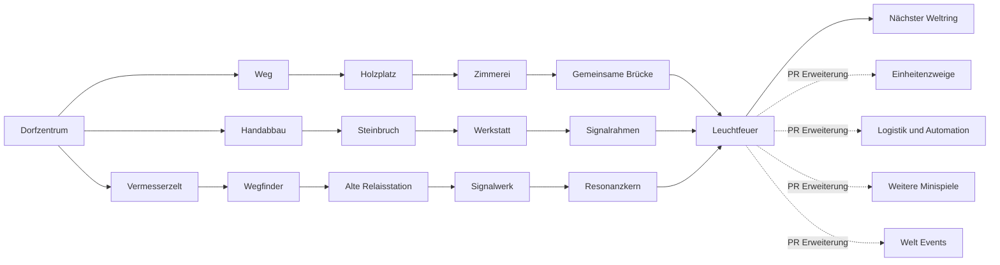

# MERGEFORGE Visual Styles and First Seven Days

Status: Concept proposal for approval

This addendum compares two realistic visual directions for the first playable screen and defines the first seven in-game days. An in-game day is a self-paced chapter of roughly 10 to 25 minutes, not a real calendar day. There is no daily login requirement.

## Style A Diorama Lite

Diorama Lite gives MERGEFORGE the emotional pull of the original reference while avoiding real-time 3D. The map uses a fixed isometric camera and pre-rendered or illustrated 2D sprites that look three-dimensional. Hex tiles, buildings, trees, rocks and fog are reusable assets.

### Visual promise

- Warm miniature world with clear height and depth
- Strong screenshots and visible village growth
- Fixed light direction and camera angle
- Small animations limited to smoke water flags selection and fog

### Feasibility

- Rendering: Canvas or PixiJS with 2D sprites and HTML interface
- Asset effort: medium
- Runtime complexity: medium
- Contributor friendliness: good when perspective palette and light direction are locked
- Main risk: contributors create assets that do not match the shared perspective

### Production limits

- Five base terrain types with at most three variants each
- One fixed camera and no rotation
- No dynamic 3D lighting
- Buildings use idle selected inactive and construction states only
- The interface remains normal HTML and CSS rather than being painted into the map

## Style B Living Atlas

Living Atlas turns the world into an interactive illustrated board game. Hex tiles are flat vector illustrations with inked contours and token-like buildings. The result is less cinematic but highly readable and easy to extend through pull requests.

### Visual promise

- Distinct fantasy atlas identity
- Excellent readability at any zoom level
- New content can be contributed as SVG or simple layered illustrations
- Fog borders resource symbols and ownership are easy to understand

### Feasibility

- Rendering: SVG for a small map or Canvas for larger regions with HTML interface
- Asset effort: low
- Runtime complexity: low
- Contributor friendliness: excellent
- Main risk: the world can feel static unless selection fog water and events receive subtle motion

### Production limits

- Two shadow levels and no perspective matching
- One reusable outline system for every asset
- Buildings are tokens rather than miniature scenes
- Motion is reserved for selection fog water signals and world events

## Recommendation

Use Diorama Lite with the production discipline of Living Atlas. The fixed camera reusable sprites and limited states keep it feasible while the miniature world preserves the emotional impact that made the original concept convincing. Living Atlas remains the safe fallback if asset production becomes the bottleneck.

The generated screens are style studies. Their resource icons are illustrative. The approved MVP economy still uses only wood and stone.

## The first seven in-game days

The prologue is called The First Signal. The players do not simply finish a tutorial. They restore the first node of an ancient network that later gives contributors natural places to attach new systems.

| Day | Chapter | Player actions | New unlock | End beat |
|---|---|---|---|---|
| 1 | The First Spark | Inspect the village reveal two neighboring hexes gather wood repair the watchfire | Paths and the build action | The watchfire exposes the silhouette of a distant relay |
| 2 | The First Chain | Build a lumber camp connect it to the village and resolve the first production round | Carpenter yard | Wood arrives automatically for the first time |
| 3 | The Map Breathes | Gather stone build the survey tent and recruit the Wegfinder | First controllable unit and quarry marker | The unit discovers a reliable stone deposit |
| 4 | A Light in the Fog | Reach a neighboring village and contribute to a shared bridge | Shared construction | Both villages can see the same ancient objective |
| 5 | The Dead Node | A fog storm interrupts one production tile and the Wegfinder uncovers the ruined relay | Signalwerk minigame | The relay reacts but lacks a resonance core |
| 6 | The Signal Workshop | Solve Signalwerk build the workshop and craft the beacon frame | Transformation recipes and workshop slot | The restored relay sends a short pulse into the fog |
| 7 | The Shared Signal | Both villages contribute wood stone and the resonance core to the beacon | Next world ring and world chronicle | The beacon ignites and reveals dormant extension sites |

## The first unit Wegfinder

The Wegfinder is deliberately not a soldier. It proves that units can exist without forcing combat into the MVP.

- Three movement points per in-game day
- Reveals adjacent fog after movement
- Surveys a resource tile and exposes its yield before a building is placed
- Can repair one event-disabled connection
- Cannot attack and cannot be lost permanently

Later pull requests can branch the same unit contract into courier pioneer guardian scholar or mounted explorer. Movement visibility ownership abilities and status effects already have a working example.

## The first minigame Signalwerk

Signalwerk is a 60 to 90 second circuit puzzle inside the ruined relay. The player rotates a five-by-five set of rune tiles until energy flows from a source crystal to the beacon core.

### Why this is the right first minigame

- It is immediately understandable and uses mouse or touch only
- It needs no physics artificial intelligence or real-time networking
- A puzzle can be generated from a seed and validated deterministically
- The world pauses no critical state while the modal is open
- The result is a simple success event that awards one resonance core
- It proves the interface slot and module contract for future games

Future pull requests can use the same minigame contract for fishing lockpicking a village card game coffee roasting or a computer terminal without changing the map engine.

## The first build and unlock tree

## The design trick

The seven-day prologue quietly validates every important extension seam without pretending to be a full strategy game.

| Prologue feature | Contract proven for later pull requests |
|---|---|
| Lumber camp and quarry | Resources production and building definitions |
| Paths and bridge | Connectivity ownership and shared construction |
| Wegfinder | Units movement abilities and status |
| Fog storm | Timed world events and repairs |
| Signalwerk | Isolated minigame interface and result event |
| Workshop | Recipes transformation and new interface slot |
| Beacon | Cooperative world objective chronicle and region unlock |

## Approval recommendation

Approve Diorama Lite as the visual target with fixed camera and sprite limits. Approve The First Signal as the seven-day prologue. Keep Living Atlas as a fallback style and as a possible low-detail map mode.

